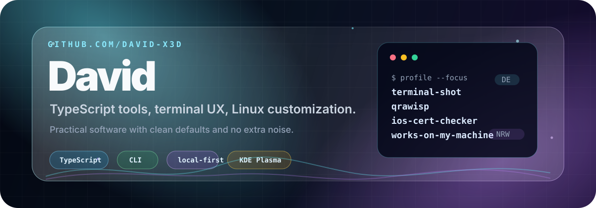

  

<h1 align="center">Hi, I'm David 👋</h1>

  Developer from NRW, Germany. I build native Android apps, small, sharp command-line tools, and polished Linux desktops.

  
  

---

## 🥗 Featured: Nomi

**Nomi** is a native Android calorie and nutrition tracker, built around fast food logging, accurate nutrition data and a clean UI.

- **Fast logging:** researched food parsing, barcode support, Open Food Facts data, favourites and meal grouping
- **Progress:** history, progress tracking and home-screen widgets
- **Your data:** backups and an in-app update checker
- **For everyone:** localisation and accessibility support

Built with Kotlin · Jetpack Compose · Android

**[View the repo →](https://github.com/david-x3d/nomi)** &nbsp;·&nbsp; **[Download the latest release →](https://github.com/david-x3d/nomi/releases/latest)**

---

## 🛠️ More projects

### Command-line tools

| Project | What it does | Stack |
| --- | --- | --- |
| [`terminal-shot`](https://github.com/david-x3d/terminal-shot) | Turns text, commands and ANSI output into good-looking terminal screenshots. | TypeScript, ANSI |
| [`qrawisp`](https://github.com/david-x3d/qrawisp) | Fast QR codes, straight from your terminal. | TypeScript |
| [`ios-cert-checker`](https://github.com/david-x3d/ios-cert-checker) | Privacy-first, fully local inspection of iOS signing certificates and provisioning profiles. | TypeScript, iOS tooling |
| [`works-on-my-machine`](https://github.com/david-x3d/works-on-my-machine) | Explains why a repo works somewhere else but not on your machine. | TypeScript, diagnostics |

### Linux desktop

| Project | What it does | Stack |
| --- | --- | --- |
| [`kde-plasma-liquid-glass-theme`](https://github.com/david-x3d/kde-plasma-liquid-glass-theme) | A Liquid Glass look for KDE Plasma, inspired by macOS Tahoe. | Shell, KDE Plasma |

---

## 🧰 Toolbox

**Mobile** 

**Web & CLI** 

**Linux & DevOps** 

---

  Like something here? A ⭐ on the repo is always appreciated.

